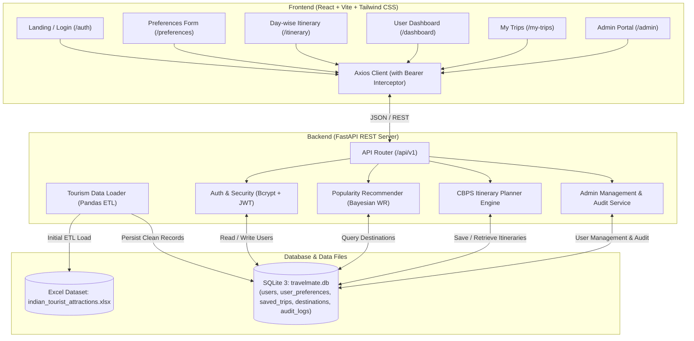
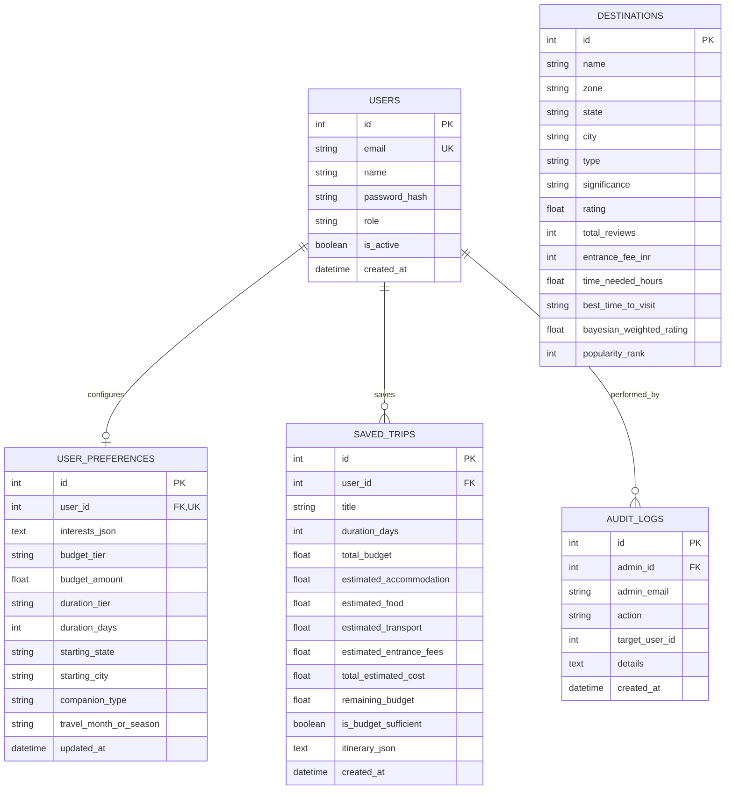

# Travel Mate 🌍
> **Discover Places. Explore Experiences.**

Travel Mate is a modern, responsive full-stack tourism intelligence and trip-planning web application designed to help travelers discover iconic destinations, landmarks, and cultural heritage sites across India. Powered strictly by a **Popularity-Based Recommendation Algorithm** (Bayesian Weighted Rating) and a **Candidate-Based Permutation Scheduling (CBPS)** itinerary optimization engine, Travel Mate generates personalized, non-repeating, day-by-day travel schedules with transparent financial cost allocations.

---

## Table of Contents
1. [Project Introduction](#1-project-introduction)
2. [Problem Statement](#2-problem-statement)
3. [Objectives](#3-objectives)
4. [Technologies Used](#4-technologies-used)
5. [System Architecture](#5-system-architecture)
6. [Dataset Description](#6-dataset-description)
7. [Popularity-Based Recommendation Algorithm](#7-popularity-based-recommendation-algorithm)
8. [Permutation-Based CBPS Formula](#8-permutation-based-cbps-formula)
9. [Database Description](#9-database-description)
10. [Project Features](#10-project-features)
11. [Frontend and Backend Structure](#11-frontend-and-backend-structure)
12. [Installation Instructions](#12-installation-instructions)
13. [How to Run the Project](#13-how-to-run-the-project)
14. [Screenshots](#14-screenshots)
15. [Future Enhancements](#15-future-enhancements)

---

## 1. Project Introduction

**Travel Mate** is an authentic Indian tourism planning platform built to simplify how travelers explore India. Rather than relying on black-box machine learning models or artificial synthetic rankings, Travel Mate anchors its intelligence in real statistical data from **321 verified attractions across 32 Indian states and 212 cities**.

### Core Philosophy
* **Pure Statistical Popularity**: Eliminates cold-start issues, sparse matrix problems, and opaque recommendations by using Bayesian Weighted Ratings ($WR$) derived from genuine Google review volumes and scores.
* **Algorithmic Integrity**: Explicitly avoids Neural Collaborative Filtering (NCF), Matrix Factorization (SVD/ALS), Item-Based CF, or hybrid models.
* **Deterministic Optimization**: Schedules morning, afternoon, and evening attractions using a **Candidate-Based Permutation Scheduling (CBPS)** framework that respects geographic proximity, travel interests, and budget constraints.
* **Financial Transparency**: Provides transparent cost projections (accommodation, dining, local transit, and verified entrance fees) with clear disclaimers, never misrepresenting estimates as verified commercial prices.

---

## 2. Problem Statement

Travel planning in India presents several distinct challenges:
1. **Information Fragmentation**: Attraction timings, entry fees, and credibility metrics are scattered across numerous unverified portals.
2. **Recommendation Cold-Start**: Traditional Collaborative Filtering algorithms fail for new users who have not yet submitted dozens of ratings.
3. **Rating Bias**: A niche attraction with two 5.0-star reviews often outranks a globally renowned monument with 200,000 reviews averaging 4.8 stars on basic average-rating sorts.
4. **Impractical Itineraries**: Most digital planners fail to consider intra-day slot scheduling (morning, afternoon, evening), resulting in repetitive or geographically chaotic routes.
5. **Hidden Costs**: Travelers rarely receive itemized financial projections distinguishing fixed attraction fees from variable lodging and transit expenses.

---

## 3. Objectives

* Build a responsive, accessible web application with **React 18**, **Tailwind CSS**, and **FastAPI**.
* Implement a mathematically rigorous **Bayesian Weighted Rating ($WR$)** formula to normalize review counts against average ratings.
* Develop a **Candidate-Based Permutation Scheduling (CBPS)** algorithm that generates $3 \times N$ unique, non-repeating attractions for an $N$-day vacation.
* Provide an itemized **Financial Projection Engine** calculating realistic stays, dining, transit, and actual dataset entrance fees.
* Deliver a secure **Role-Based Access Control (RBAC)** architecture separating standard travelers from administrative operations, complete with an **Admin Dashboard** and **Audit Logging**.
* Ensure 100% data persistence using **SQLite** and **SQLAlchemy 2.x**.

---

## 4. Technologies Used

### Frontend
* **React 18 (v18.3.1)**: Modern component architecture using hooks (`useState`, `useEffect`, `useContext`).
* **Vite (v6.4.5)**: High-performance build tool and hot module replacement (HMR).
* **Tailwind CSS (v3.4.17)**: Utility-first styling with responsive, modern UI design.
* **React Router DOM (v6.28.0)**: Client-side routing, protected routes, and navigation guards.
* **Axios (v1.7.9)**: Promise-based HTTP client with request/response JWT bearer interceptors.
* **Recharts (v2.15.0)**: Interactive charting for interest distributions and budget tiers.
* **Lucide React (v0.475.0)**: Modern, lightweight iconography.

### Backend
* **Python 3.11+ / 3.13**: Modern Python runtime.
* **FastAPI (v0.115.0+)**: High-speed asynchronous REST API framework with automatic OpenAPI documentation.
* **Uvicorn (v0.32.0+)**: Lightning-fast ASGI production web server.
* **Pydantic (v2.9.0+) & Pydantic-Settings**: Strict request validation, data serialization, and configuration management.
* **Pandas (v2.2.0+) & NumPy (v1.26.0+)**: Data wrangling, statistical thresholding, and Bayesian ranking computations.
* **OpenPyXL (v3.1.5)**: Native Excel reader for raw dataset ingestion.

### Database & Security
* **SQLite 3**: Lightweight, zero-configuration relational database stored at `backend/data/processed/travelmate.db`.
* **SQLAlchemy (v2.0.0+)**: Declarative ORM models with relational joins and cascade constraints.
* **Passlib / Bcrypt (v4.2.0+)**: 12-round salted cryptographic password hashing.
* **PyJWT (v2.10.0+)**: Secure JSON Web Token authentication with expiration enforcement.

---

## 5. System Architecture



---

## 6. Dataset Description

The application is grounded in the **Indian Tourist Attractions Dataset**, curated from verified repository sources:
* **Source Repository**: [SampurnaK/indian-tourist-attractions-analysis](https://github.com/SampurnaK/indian-tourist-attractions-analysis)
* **File Location**: `datasets/india/indian_tourist_attractions.xlsx`
* **Coverage**: **321 attractions across 32 Indian States & Union Territories** and **212 unique cities**.

### Ingested Schema Fields
| Dataset Column | Database Attribute | Type | Description |
| :--- | :--- | :--- | :--- |
| `ID` | `id` | `INTEGER` | Unique primary key identifier |
| `Name` | `name` | `VARCHAR(255)` | Attraction name (e.g. Golden Temple, Kedarnath) |
| `Zone` | `zone` | `VARCHAR(100)` | Geographic region (North, South, East, West, Central, North East) |
| `State` | `state` | `VARCHAR(100)` | Indian State or Union Territory |
| `City` | `city` | `VARCHAR(100)` | District / City location |
| `Type` | `type` | `VARCHAR(100)` | Category (Temple, Fort, Beach, Palace, Wildlife Sanctuary, etc.) |
| `Google_Review_Rating` | `rating` | `FLOAT` | Average review rating ($1.0 - 5.0$) |
| `Number_Of_Google_Review_In_Lakhs` | `reviews_lakhs` | `FLOAT` | Raw review volume in lakhs ($10^5$) |
| *(Calculated)* | `total_reviews` | `INTEGER` | Scaled integer review count ($\text{reviews\_lakhs} \times 100,000$) |
| `Entrance_Fee_In_INR` | `entrance_fee_inr` | `INTEGER` | Entrance ticket price in Indian Rupees (₹) |
| `Time_Needed_To_Visit_In_Hrs` | `time_needed_hours` | `FLOAT` | Recommended duration of visit in hours |
| `Best_Time_To_Visit` | `best_time_to_visit` | `VARCHAR(100)` | Recommended visitation time (Morning, Afternoon, Evening, All Day) |
| `Significance` | `significance` | `VARCHAR(100)` | Historical, religious, or ecological significance |
| `Airport_Within_50km` | `airport_within_50km` | `BOOLEAN` | Proximity to commercial airport |
| `Weekly_Off` | `weekly_off` | `VARCHAR(100)` | Day of weekly closure (or "None") |
| `DSLR_Allowed` | `dslr_allowed` | `BOOLEAN` | Photography permission flag |

---

## 7. Popularity-Based Recommendation Algorithm

To eliminate manipulation by low-volume extreme ratings, Travel Mate computes the **Bayesian Weighted Rating ($WR$)** (IMDb Weighted Mean):

$$WR = \left(\frac{v}{v + m}\right) \cdot R + \left(\frac{m}{v + m}\right) \cdot C$$

### Component Definitions
* **$v$ (Review Count)**: The total volume of verified reviews accumulated by the attraction.
* **$m$ (Credibility Threshold)**: The minimum review count required for an attraction to be ranked primarily on its own rating. In Travel Mate, $m$ is set dynamically to the **50th percentile (median) of the dataset**, which is **$17,000$ reviews**.
* **$R$ (Average Rating)**: The attraction's average Google review score ($1.0 - 5.0$).
* **$C$ (Dataset Mean Rating)**: The baseline mean rating across all 321 attractions in India, calculated as **$C = 4.4925$**.

### Statistical Behavior
* **High Volume ($v \gg m$)**: As reviews increase, $\frac{v}{v+m} \to 1$, allowing the attraction's actual rating $R$ to dominate.
* **Low Volume ($v \ll m$)**: As review counts drop, $\frac{m}{v+m} \to 1$, regressing the attraction's score safely toward the national mean $C$ to avoid deceptive 5.0-star ratings with few reviews.

### National Top 3 Attractions
1. **Golden Temple** (Amritsar, Punjab) — $R = 4.90$, $v = 240,000$, **$WR = 4.8665$**
2. **Kedarnath Temple** (Kedarnath, Uttarakhand) — $R = 4.80$, $v = 130,000$, **$WR = 4.7759$**
3. **Mahakaleshwar Jyotirlinga** (Ujjain, Madhya Pradesh) — $R = 4.80$, $v = 100,000$, **$WR = 4.7618$**

---

## 8. Permutation-Based CBPS Formula

Travel Mate implements **Candidate-Based Permutation Scheduling (CBPS)** to generate personalized, non-repeating day-wise itineraries.

### 1. Multi-Objective Candidate Scoring Formula
For each candidate attraction $d$ and user preference profile $u$, a multi-objective utility score $S(d, u)$ is computed:

$$S(d, u) = G(d, u) + I(d, u) + 2.0 \cdot WR(d)$$

#### A. Geographical Alignment Score $G(d, u)$
Prioritizes attractions in the user's declared starting base:

$$G(d, u) = \begin{cases} 
15.0 & \text{if } \text{State}(d) = \text{State}(u) \text{ and } \text{City}(d) = \text{City}(u) \\ 
10.0 & \text{if } \text{State}(d) = \text{State}(u) \text{ and } \text{City}(d) \neq \text{City}(u) \\ 
0.0 & \text{otherwise} 
\end{cases}$$

#### B. Interest Category Alignment Score $I(d, u)$
Matches the user's multi-selected interests (e.g., Historical, Spiritual, Nature) against attraction types and significance tags:

$$I(d, u) = \begin{cases} 
8.0 & \text{if } \text{Type}(d) \in \text{MappedCategories}(\text{Interests}(u)) \\ 
5.0 & \text{if } \exists\, k \in \text{Interests}(u) \text{ such that } k \subseteq \text{Significance}(d) \\ 
0.0 & \text{otherwise} 
\end{cases}$$

#### C. Popularity Weighting ($2.0 \cdot WR(d)$)
Anchors the final selection in statistical prominence, ensuring that top-tier attractions are prioritized even within regional and interest filters.

---

### 2. Day-Wise Permutation & Scheduling ($3 \times N$ Non-Repeating Slots)
For an $N$-day tour, the planner selects the top $3N$ unique attractions from the ranked candidate list:

$$\mathcal{D}_{\text{selected}} = \text{Top}_{3N} \Big( \operatorname{sort}_{\text{desc}} \big( \{ d \in \mathcal{D} \mid S(d, u) \} \big) \Big)$$

The selected set is permuted sequentially across days into Morning, Afternoon, and Evening slots:

$$\text{Day } k = \Big( \text{Morning}: d_{3k-2}, \; \text{Afternoon}: d_{3k-1}, \; \text{Evening}: d_{3k} \Big) \quad \text{for } k \in \{1, 2, \dots, N\}$$

$$\text{Constraint: } \quad d_i \neq d_j \quad \forall i \neq j \quad (\text{Strictly zero duplicate attractions})$$

---

### 3. Financial Allocation & Budget Advisory Model
Travel Mate calculates estimated expenses using standardized companion-aware daily baseline rates combined with real dataset entrance fees:

$$C_{\text{total}} = N \cdot \left( C_{\text{hotel}}^{(\text{group})} + C_{\text{food}}^{(\text{group})} + C_{\text{transit}}^{(\text{group})} \right) + \sum_{i=1}^{3N} \text{Fee}(d_i)$$

#### Baseline Daily Rates by Companion Group (INR)
| Companion Group | Daily Accommodation ($C_{\text{hotel}}$) | Daily Dining ($C_{\text{food}}$) | Daily Local Transit ($C_{\text{transit}}$) |
| :--- | :---: | :---: | :---: |
| **Solo** | ₹900 | ₹500 | ₹350 |
| **Couple** | ₹1,800 | ₹1,000 | ₹500 |
| **Friends** | ₹2,000 | ₹1,200 | ₹600 |
| **Family** | ₹2,400 | ₹1,600 | ₹700 |

#### Budget Compliance Check
$$\Delta B = B_{\text{user}} - C_{\text{total}}$$
* If $\Delta B \ge 0$: Itinerary is marked **Budget Sufficient** with surplus $\Delta B$.
* If $\Delta B < 0$: Itinerary displays an **Exceeds Budget** notice with the exact deficit $|\Delta B|$ and suggests actionable cost adjustments.

---

## 9. Database Description

All data is persistently stored in SQLite via SQLAlchemy ORM at:  
`backend/data/processed/travelmate.db`

### Entity Relationship Diagram


---

## 10. Project Features

### 1. Authentication & Security
* **Landing Entry Gateway**: The site opens directly to an attractive tourism-themed login and registration portal.
* **Bcrypt Password Security**: Zero plaintext password storage.
* **JWT Bearer Authentication**: Role-encoded signed access tokens.
* **Password Reset Workflow**: Built-in reset request and verification flow.

### 2. User Travel Preferences Form
* **Multi-Select Interests**: 10 distinct categories (Historical Places, Nature & Wildlife, Beaches, Hill Stations, Temples & Spiritual, Adventure, Cultural, Museums, Waterfalls, Family Destinations).
* **Budget Tiers**: 5 predefined tiers plus custom amount inputs.
* **Flexible Duration**: 1, 2, 3, 5, 7 days, or custom numbers of days.
* **Dynamic Origin**: 32 Indian states and 212 cities.
* **Single Record Guarantee**: Updating preferences updates the existing record without creating duplicates.

### 3. Personalized Day-wise Itinerary
* **Tri-Slot Day Scheduling**: Distinct Morning, Afternoon, and Evening activities.
* **Rich Attraction Cards**: Category badges, review counts in lakhs, entrance fees, and visiting hours.
* **Itemized Expense Breakdown**: Accommodation, dining, transit, and ticket totals.
* **Surplus / Deficit Indicator**: Budget advisory with adjustment recommendations.

### 4. Saved Trips & Export
* **Permanent SQLite Storage**: Trips are stored under the user's profile and persist across sessions.
* **Export Itinerary**: Download clean formatted `.txt` itinerary summaries.
* **Interactive Management**: View schedules, refresh lists, and delete trips.

### 5. Dedicated Admin Portal
* **Role Guard**: Access restricted strictly to users with `role == "admin"`.
* **5 Real-Time KPI Cards**: Total Users, Active Users, Inactive Users, Total Saved Trips, and Total Destinations.
* **Analytical Visualizations**: Recharts distributions of top interests and budget preferences.
* **9-Column User Management**: User ID, Name, Email, Registration Date, Status, Interests, Budget, Duration, and Saved Trips Count.
* **User Profile Inspection Modal**: Complete visibility into any user's profile, preferences, itemized costs, and day-wise attractions.
* **Account Status Toggle**: One-click activate/deactivate with audit logging.
* **Administrative Audit Logs**: Chronological log of administrative operations.

---

## 11. Frontend and Backend Structure

```
travelmate/
├── backend/
│   ├── app/
│   │   ├── api/
│   │   │   └── v1/
│   │   │       ├── admin.py             # Admin analytics, user management, audit logs
│   │   │       ├── api.py               # API route registry
│   │   │       ├── auth.py              # User registration, login, JWT issuance
│   │   │       ├── destinations.py      # Destination queries, filters, metadata
│   │   │       ├── itineraries.py       # Day-wise itinerary generation, persistence
│   │   │       ├── preferences.py       # User travel preference persistence
│   │   │       └── recommendations.py   # Bayesian popularity ranking endpoints
│   │   ├── models/
│   │   │   ├── audit.py                 # AuditLog SQLAlchemy model
│   │   │   ├── destination.py           # Destination SQLAlchemy model
│   │   │   ├── preference.py            # UserPreference SQLAlchemy model
│   │   │   ├── trip.py                  # SavedTrip SQLAlchemy model
│   │   │   └── user.py                  # User SQLAlchemy model
│   │   ├── schemas/
│   │   │   ├── destination.py           # Destination response schemas
│   │   │   ├── preference.py            # Preference request & response schemas
│   │   │   ├── trip.py                  # Itinerary & saved trip schemas
│   │   │   └── user.py                  # Auth, registration, and user schemas
│   │   ├── services/
│   │   │   ├── data_loader.py           # Excel ingestion & Bayesian ETL
│   │   │   ├── planner.py               # CBPS day-wise itinerary & expense engine
│   │   │   ├── recommender.py           # Popularity queries & filtering
│   │   │   └── seeder.py                # Database seeder (admin & traveler accounts)
│   │   ├── utils/
│   │   │   └── security.py              # Bcrypt hashing, JWT decode, RBAC dependencies
│   │   ├── config.py                    # Application configuration & CORS settings
│   │   ├── database.py                  # SQLite engine & session factory
│   │   └── main.py                      # FastAPI application entry point
│   ├── data/
│   │   └── processed/
│   │       └── travelmate.db            # Persistent SQLite database file
│   ├── requirements.txt                 # Backend Python dependencies
│   └── .env.example
├── datasets/
│   └── india/
│       └── indian_tourist_attractions.xlsx # Raw Indian tourism dataset
├── frontend/
│   ├── public/                          # Static assets and icons
│   ├── src/
│   │   ├── components/
│   │   │   ├── common/
│   │   │   │   ├── Navbar.jsx           # Top navigation bar
│   │   │   │   └── Footer.jsx           # Global footer with dataset attribution
│   │   │   ├── destinations/
│   │   │   │   ├── DestinationCard.jsx  # Attraction card component
│   │   │   │   └── DestinationGrid.jsx  # Responsive destination grid
│   │   │   └── recommendations/
│   │   │       └── PopularitySection.jsx # Popularity highlights showcase
│   │   ├── context/
│   │   │   └── TripContext.jsx          # Global auth state & trip persistence provider
│   │   ├── pages/
│   │   │   ├── AdminDashboardPage.jsx   # Admin portal & user inspection
│   │   │   ├── AdminLoginPage.jsx       # Admin login gateway
│   │   │   ├── AuthPage.jsx             # User login & registration portal
│   │   │   ├── CategoryRecommendationsPage.jsx # Category explorer
│   │   │   ├── CityRecommendationsPage.jsx     # City highlights explorer
│   │   │   ├── DestinationDetailPage.jsx       # Attraction details view
│   │   │   ├── ExplorePage.jsx          # All 321 attractions catalog
│   │   │   ├── HomePage.jsx             # Public tourism showcase
│   │   │   ├── ItineraryPage.jsx        # Day-wise itinerary & cost breakdown
│   │   │   ├── MyTripsPage.jsx          # Saved trips management & text export
│   │   │   ├── PopularDestinationsPage.jsx     # Top 10 national ranking
│   │   │   ├── PreferencesPage.jsx      # Travel preference setup form
│   │   │   ├── SeasonalRecommendationsPage.jsx # Seasonal travel explorer
│   │   │   ├── StateRecommendationsPage.jsx    # State-wise explorer
│   │   │   └── TripPlannerPage.jsx      # Interactive manual trip builder
│   │   ├── services/
│   │   │   └── api.js                   # Centralized Axios client & API endpoints
│   │   ├── App.jsx                      # Route definitions & guards
│   │   ├── main.jsx                     # Vite entry point
│   │   └── index.css                    # Tailwind directives & styles
│   ├── index.html
│   ├── package.json                     # Frontend dependencies & scripts
│   ├── tailwind.config.js
│   ├── vite.config.js
│   └── .env                             # Frontend environment configuration
├── scratch/
│   └── test_e2e_workflow.py             # Automated end-to-end test suite
└── README.md
```

---

## 12. Installation Instructions

### Prerequisites
* **Python 3.10+** (Tested on Python 3.11 and 3.13)
* **Node.js 18+** & **npm 9+**
* **Git** (optional)

### Step 1: Clone or Navigate to the Project
```powershell
cd c:\Users\VENKAT\OneDrive\Desktop\travelmate
```

### Step 2: Set Up Backend Environment
```powershell
cd backend

# Create virtual environment (optional but recommended)
python -m venv venv
.\venv\Scripts\activate

# Install dependencies
pip install -r requirements.txt
```

### Step 3: Set Up Frontend Environment
```powershell
cd ..\frontend

# Install node dependencies
npm install
```

---

## 13. How to Run the Project

Open **two separate terminal windows**:

### Terminal 1: Launch FastAPI Backend
```powershell
cd backend
$env:PYTHONPATH = "."
python -m uvicorn app.main:app --port 8000 --reload
```
* **API Documentation (Swagger UI)**: [http://localhost:8000/docs](http://localhost:8000/docs)
* **Health Check**: [http://localhost:8000/health](http://localhost:8000/health)

---

### Terminal 2: Launch Vite React Frontend
```powershell
cd frontend
npm run dev
```
* **Frontend Web Application**: [http://localhost:5173](http://localhost:5173)

---

### Pre-Seeded Login Credentials

| Role | Access URL | Email | Password |
| :--- | :--- | :--- | :--- |
| **Traveler** | [http://localhost:5173/](http://localhost:5173/) | `traveler@travelmate.com` | `Traveler@123` |
| **Administrator** | [http://localhost:5173/admin/login](http://localhost:5173/admin/login) | `admin@travelmate.com` | `AdminPassword@123` |

*(You can also register a brand new account directly on the landing page).*

---

## 14. Screenshots

> *The interface uses high-contrast typography, emerald/sky status badges, and responsive Tailwind cards.*

### 1. Landing & Authentication Gateway (`/`)
*Modern split-panel login and registration interface featuring Travel Mate branding, secure password hashing, and forgot-password recovery options.*

### 2. Travel Preferences Setup (`/preferences`)
*Interactive form with multi-select interest cards (Forts, Temples, Beaches, Wildlife), 5 budget tier selections, duration selectors, origin state/city dropdowns, and group type toggles.*

### 3. Personalized Day-Wise Itinerary (`/itinerary`)
*Complete day-by-day Morning, Afternoon, and Evening schedule cards with ratings, entrance fees, suggested visiting hours, and transparent financial breakdown panels (stays, meals, transit, tickets).*

### 4. User Dashboard & Saved Trips (`/dashboard`, `/my-trips`)
*Profile overview displaying active preferences, quick access to generated plans, stored trip cards, and one-click `.txt` itinerary downloads.*

### 5. Administrator Control Portal (`/admin`)
*Comprehensive dashboard with 5 real-time KPI cards, Recharts preference distribution graphs, a 9-column User Management table, account activation/deactivation controls, and full user inspection modals.*

---

## 15. Future Enhancements

* **Interactive Map Visualization**: Integrate Leaflet / Mapbox to render geospatial route markers connecting scheduled morning, afternoon, and evening destinations.
* **Live Weather Integration**: Connect OpenWeatherMap API to display seasonal climate advisories and precipitation forecasts for scheduled travel months.
* **Multi-City Route Chaining**: Enable cross-state itineraries with inter-city rail and flight duration estimators between distinct regions.
* **PDF Itinerary Generator**: Export formatted, branded PDF travel brochures complete with destination photographs and booking checklists.
* **Multi-Language Support**: Provide localized interfaces in Hindi, Tamil, Telugu, Bengali, and other major Indian languages.

---

## License & Attribution

* **Dataset Credit**: [SampurnaK/indian-tourist-attractions-analysis](https://github.com/SampurnaK/indian-tourist-attractions-analysis).
* **Project**: Developed as an academic and engineering demonstration of **Statistical Popularity-Based Recommendations** and **Candidate-Based Permutation Scheduling (CBPS)**.
* **License**: MIT License. Free for educational and research use.
